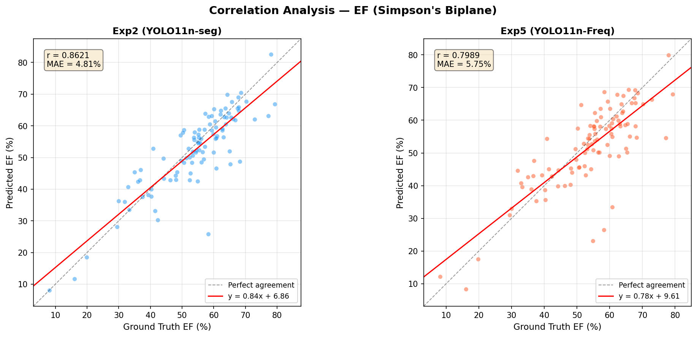
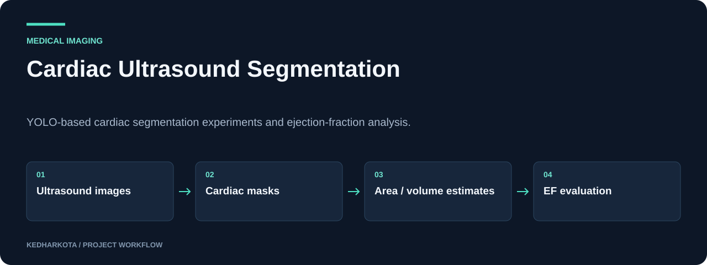

# Cardiac Ultrasound Segmentation

YOLO-based cardiac segmentation experiments and ejection-fraction analysis.

**Python · YOLO11 · CAMUS · Streamlit · Computer vision**

[Overview](#overview) · [Getting started](#getting-started) · [Repository guide](#repository-guide) · [Reproducibility](docs/REPRODUCIBILITY.md)



*Original aggregate ejection-fraction evaluation plot from results.zip.*

## Overview

A cardiac imaging research repository comparing segmentation architectures on CAMUS ultrasound data and using predicted structures for ejection-fraction estimation. The current documentation and `results.zip` describe ultrasound segmentation, although the historical repository name mentions heart murmurs.

## What this project includes

- YOLO11n-seg baseline and attention, UNet, and frequency-domain variants.
- Experiments targeting left ventricle, myocardium, and left atrium segmentation.
- Ejection-fraction comparisons with scatter and Bland-Altman analyses.
- An archived Streamlit demo with optional Gemini-assisted narrative output.

## Workflow



*Explanatory diagram. Detailed implementation and availability notes follow below.*

## Getting started

Start with `PROJECT_DOCUMENTATION.md`. Extract `results.zip` to a separate local project directory, inspect its experiment notebooks, and restore their data and model paths.

The archive contains `app.py` and notebooks for experiments 2–5. Once the expected YOLO weights and Python dependencies are supplied, launch the archived demo from the extracted directory:

```bash
streamlit run app.py
```

The demo reads an optional `GEMINI_API_KEY` from the environment. A full environment lockfile and trained model weights are not included in the repository root.

### Required inputs and current constraints

Obtain the CAMUS data through its official access process and reproduce the documented preprocessing and split. The app expects a YOLO model path, and experiment notebooks reference external training assets. The included plots and CSVs are historical experiment outputs. This is a research prototype, with no clinical validation established here.

## Repository guide

| File | Purpose |
| --- | --- |
| [PROJECT_DOCUMENTATION.md](PROJECT_DOCUMENTATION.md) | Complete ultrasound project methodology and reported results. |
| [results.zip](results.zip) | Contains experiment notebooks, app.py, result tables, and plots. |
| [Smart_Cardiac_Screening_TeamA7.pptx.pptx](Smart_Cardiac_Screening_TeamA7.pptx.pptx) | Additional committed presentation; retains its original filename. |
| [final_ppt.pptx](final_ppt.pptx) | Project presentation. |

## Results and project status

The committed `results/ef_metrics_summary.csv` inside the archive reports Exp 2 ejection-fraction MAE **4.8109 percentage points** and Pearson r **0.8621** on **100** cases. The archived Exp 2 segmentation summary reports mean DSC **0.9059**. These are source-reported experiment results, not independently reproduced measurements. The aggregate preview above comes from that same archive.

## Next steps

- Move the archived application and notebooks into browsable source directories.
- Record exact environment, checkpoint locations, and dataset split identifiers.

## Documentation maintenance

Local documentation links and image headers are checked on pull requests and relevant pushes by the [documentation workflow](.github/workflows/docs.yml). Run the same check locally:

```bash
python tools/check_docs.py
```

See the [reproducibility guide](docs/REPRODUCIBILITY.md) for evidence, missing artifacts, and visual-source notes. The check validates documentation files; it does not train models or certify application behavior.

---

[More projects by kedharkota](https://github.com/kedharkota?tab=repositories)
